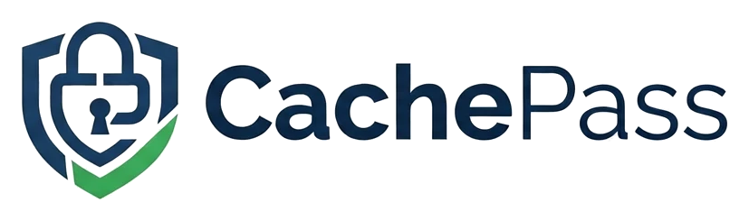

<p align="center">
  <picture>
    <source media="(prefers-color-scheme: dark)" srcset=".github/assets/cachepass-logo-dark.png">
    
  </picture>
</p>

<h3 align="center">CachePass Web App</h3>

<p align="center">
  The CachePass password manager client.<br>
  <strong>All vault encryption and decryption happens here, in your browser.</strong>
</p>

<p align="center">
  <a href="LICENSE"></a>
  
  
  <a href="https://github.com/CachePass/cachepass-docs/blob/main/docs/ROADMAP.md#security-audit-milestones"></a>
</p>

<p align="center">
  <a href="#features">Features</a> ·
  <a href="#how-encryption-works">Encryption</a> ·
  <a href="#getting-started">Getting started</a> ·
  <a href="#testing">Testing</a> ·
  <a href="#deployment">Deployment</a> ·
  <a href="#security">Security</a>
</p>

---

A static SvelteKit single-page application with a Rust crypto engine compiled to
WebAssembly. It talks to the [CachePass API](https://github.com/CachePass/cachepass-backend),
which only ever receives ciphertext. The cryptographic format is specified in
[CRYPTOGRAPHY.md](https://github.com/CachePass/cachepass-docs/blob/main/docs/CRYPTOGRAPHY.md).

> [!IMPORTANT]
> CachePass is **pre-1.0 and has not been independently audited**. Read the
> [threat model](https://github.com/CachePass/cachepass-docs/blob/main/docs/THREAT_MODEL.md)
> and the [security notes](#security) below before relying on it.

## Features

| Area           | What you get                                                                                                              |
| -------------- | ------------------------------------------------------------------------------------------------------------------------- |
| **Vault**      | Logins, secure notes, payment cards, identities and SSH keys · folders · favourites · trash and restore · custom fields   |
| **Search**     | Instant local search, filtering and sorting over decrypted data — secrets are never indexed                               |
| **Generators** | Password and passphrase generator (browser CSPRNG, EFF wordlist), strength meter, live TOTP codes                         |
| **Protection** | Auto-lock on inactivity or hidden tab, clipboard auto-clear, local weak / reused password report                          |
| **Account**    | Sign-in with optional TOTP 2FA, master and account password changes, sessions, devices, activity log                      |
| **Experience** | Command palette (<kbd>⌘</kbd>/<kbd>Ctrl</kbd>+<kbd>K</kbd>), keyboard shortcuts, light and dark themes, responsive layout |

## How encryption works

1. The master password is NFC-normalised and handed to a dedicated **Web Worker**.
2. The worker derives a key-encryption key with **Argon2id** (64 MiB, 3 passes by
   default) and **HKDF-SHA-256**, and unwraps the random 256-bit vault key with
   **XChaCha20-Poly1305**. The derived key is zeroized immediately.
3. The vault key stays inside the worker's WebAssembly memory behind an opaque
   handle; JavaScript never sees it.
4. Each item and folder is encrypted as one padded JSON document, bound to its
   vault and item id through authenticated associated data.
5. **Locking** terminates the worker, discarding its memory, clears the decrypted
   store and any pending clipboard secret.

Nothing decrypted is written to `localStorage`, `sessionStorage`, IndexedDB,
cookies or URLs. Only non-sensitive preferences (theme, auto-lock time, clipboard
timeout, sort order) are persisted.

## Project structure

```
crypto/                 Rust crate (Argon2id, HKDF-SHA-256, XChaCha20-Poly1305) → WebAssembly
src/lib/crypto/         generated WASM bindings (committed), worker, typed engine facade
src/lib/api/            fetch client (CSRF, uniform errors) + Zod mirrors of openapi.json
src/lib/schemas/        encrypted item and folder payload schemas (Zod)
src/lib/stores/         session · vault (decrypted, memory only) · settings · ui
src/lib/features/       authentication · vault (search, TOTP, clipboard) · generator · security
src/lib/components/     ui (shadcn-svelte) · layout · vault · auth · shared
src/routes/(auth)/      login · register · verify-email · forgot / reset password · unlock
src/routes/(app)/       vault · favorites · trash · folders · generator · security · settings
e2e/                    Playwright tests against a real backend
```

## Getting started

### Prerequisites

- [Bun](https://bun.sh) ≥ 1.4
- A running [cachepass-backend](https://github.com/CachePass/cachepass-backend) for anything
  beyond unit tests
- Only to rebuild the WebAssembly engine: Rust stable with the `wasm32-unknown-unknown`
  target and `wasm-bindgen-cli 0.2.130`

### Run locally

```sh
bun install
bun run dev                                          # http://localhost:5173, proxies /api → :8080
CACHEPASS_API_URL=http://127.0.0.1:9000 bun run dev  # use a different backend
```

Start the backend with `CACHEPASS_PUBLIC_URL=http://localhost:5173`. The web app and
API must share one origin — the dev proxy and the production Caddy setup both do
this — so session cookies can be `SameSite=Strict`.

### Scripts

| Command               | Purpose                                                                          |
| --------------------- | -------------------------------------------------------------------------------- |
| `bun run dev`         | Development server with API proxy                                                |
| `bun run check`       | `svelte-check` and strict TypeScript                                             |
| `bun run lint`        | Prettier and type-aware ESLint                                                   |
| `bun run test`        | Unit, component and WebAssembly crypto tests (Vitest; browser tests in Chromium) |
| `bun run test:e2e`    | Playwright end-to-end tests against a real backend                               |
| `bun run test:crypto` | Rust unit tests and specification vectors of the crypto crate                    |
| `bun run build`       | Production build → `build/` (static files with a `200.html` SPA fallback)        |
| `bun run build:wasm`  | Rebuild `src/lib/crypto/wasm/` from `crypto/`                                    |
| `bun run wasm:verify` | Rebuild and fail if the committed WebAssembly differs                            |

### Working on the crypto engine

`crypto/` is a standalone Cargo crate with its own workspace. Its compiled output
in `src/lib/crypto/wasm/` is committed so the app builds with Bun alone. After
changing it:

```sh
bun run test:crypto && bun run build:wasm && bun run test
```

and commit the regenerated files. Install the matching bindgen once with
`cargo install wasm-bindgen-cli --version 0.2.130 --locked`.

## Testing

- **Cross-implementation crypto tests** — `src/lib/crypto/core.browser.spec.ts` runs the
  real WebAssembly engine in Chromium and recomputes every specification test vector
  with the independent `@noble/hashes` and `@noble/ciphers` libraries.
- **Unit and component tests** — generators, strength estimation, TOTP (RFC 6238
  vectors), search, validation, clipboard behaviour, lock races and UI components.
- **End-to-end tests** — Playwright drives registration, email verification, unlock,
  item CRUD, search, folders, trash, locking, master password change and account
  password reset against a real backend, and asserts that **no API request ever
  contains the master password or item plaintext**.

To run the end-to-end suite:

1. In `cachepass-backend`, start PostgreSQL and Mailpit:
   `docker compose -f docker-compose.dev.yml up -d`.
2. Run the backend with `CACHEPASS_PUBLIC_URL=http://localhost:4173`, SMTP pointed at
   Mailpit (`CACHEPASS_SMTP_HOST=127.0.0.1 CACHEPASS_SMTP_PORT=51025 CACHEPASS_SMTP_TLS=none`)
   and, for repeated runs, `CACHEPASS_RATE_LIMIT_ENABLED=false`.
3. `bun run test:e2e`.

## Deployment

The production image is a non-root Caddy static file server with a read-only root
filesystem and no Linux capabilities:

```sh
docker build -t cachepass-webapp:local .
```

It listens on `:8080` without TLS and is designed to sit behind the reverse proxy in
the [backend's Docker Compose stack](https://github.com/CachePass/cachepass-backend#self-hosting),
which serves `/` from this container and `/api/*` from the API on the same origin.

**Security headers.** The build emits a hash-based Content Security Policy
(`default-src 'none'; script-src 'self' 'wasm-unsafe-eval' <hash>; connect-src 'self'; …`).
`deploy/Caddyfile` adds `frame-ancestors 'none'`, `X-Frame-Options`, `nosniff`,
`Referrer-Policy: no-referrer`, `Permissions-Policy` and cache headers.

## Security

Known limitations of browser-based cryptography:

- **You must trust the server that delivers this code.** A malicious or compromised
  server, build pipeline or dependency can ship JavaScript that captures the master
  password. Zero-knowledge storage does not protect against that.
- A compromised browser, extension or operating system defeats client-side protections.
- Decrypted values exist as JavaScript strings while unlocked and cannot be reliably
  wiped from memory; CachePass drops all references on lock.
- Clipboard clearing is best effort: browsers only allow it while the page has focus,
  so a pending clear runs when the window regains focus.
- The strength meter is a heuristic estimate, not a guarantee.

Report vulnerabilities privately via a
[GitHub security advisory](https://github.com/CachePass/cachepass-webapp/security/advisories/new)
— see [SECURITY.md](https://github.com/CachePass/cachepass-docs/blob/main/docs/SECURITY.md).

## Related repositories

| Repository                                                          | Role                                                                    |
| ------------------------------------------------------------------- | ----------------------------------------------------------------------- |
| [cachepass-backend](https://github.com/CachePass/cachepass-backend) | API, database and deployment                                            |
| [cachepass-website](https://github.com/CachePass/cachepass-website) | Public product site                                                     |
| [cachepass-docs](https://github.com/CachePass/cachepass-docs)       | Architecture, cryptography specification, threat model, security policy |

## License

Licensed under the [GNU Affero General Public License v3.0 only](LICENSE).
The EFF Large Wordlist (`src/lib/features/generator/wordlist.ts`) is © Electronic
Frontier Foundation, licensed CC BY 3.0 US.
